# NET-7 plan — port map and network diagram from node-side LLDP (`vnetmap_lldp.py`)

Branch: `feature/NET-7-vnetmap-lldp` (worktree `~/asbuilt-net7`, off `develop` at `f5ea66a`). Spec:
[`spec.md`](spec.md). Release: v1.6.3 ([`../v1.6.3/spec.md`](../v1.6.3/spec.md)). Tasks: [`tasks.md`](tasks.md).

## Owner decisions (2026-11-11)

- **Source selection:** the operator picks a port-map source per run: **Auto** (default), **vnetmap** (switch
  login) or **LLDP** (from nodes). Auto uses vnetmap when switch credentials are given, and LLDP when they are
  not or when the login fails on every switch. Auto never switches when any switch login works.
- **Scripts:** `vnetmap_lldp.py` only. Switch management IPs come from the VMS switches API. The Confluence
  tcpdump / `nw_check.sh` enrichment becomes a separate follow-up item.
- **Release:** ships in v1.6.3.

## What the tool does (source read 2026-11-11, 2,071 lines)

- `--operation show-mapping` runs only read-only node commands through `clush`: `rpm -qa | grep lldp`,
  `systemctl is-active lldpad`, `sudo lldpcli show neighbors ports 
 details` (or `sudo lldptool -t -n -i 
`),
  `ip addr show`, `ip -o link show`, `hostname`, and a grep of `/etc/vast-configure_network.py-params.ini`.
  `ip link set ... down/up` exists only in `ifdown` / `ifup`.
- It **writes two files on the CNode it runs on:** `/userdata/switch_mapping.json` (overwritten on every
  `show-mapping`, and the file `ifup` later reads to restore interfaces) and `~/logs/vnetmap_<ts>.log`.
- Its own readiness check requires the `lldpad` **package** to be installed and at least one active service. It
  counts `systemctl is-active lldpad`, not `lldpd`, and its count is inflated because `"inactive"` also matches
  `"active"`. Without `-f` it stops when the package check fails.
- Output: a banner, progress lines (with `\r` and box-drawing bytes), a per-switch summary table, one table per
  switch, then the final `LLDP Connection Mapping:` table bordered with `+---+`. Columns: `Hostname | Node
  (management IP) | Port (node interface) | IPs (data IP) | Switch (LLDP system name) | Switch Port`. The run
  ends with `Operation completed successfully` or `Operation failed - see logs for details` (exit code 1).

## Design

```mermaid
flowchart LR
  ui["Source: Auto / vnetmap / LLDP"] --> sel["select_topology_source()"]
  sel -->|vnetmap| vw[VnetmapWorkflow]
  sel -->|lldp| lw[VnetmapLLDPWorkflow]
  vw -->|"login failed on every switch (Auto only)"| lw
  vw --> vout["vnetmap_output_IP_TS.txt"]
  lw --> lout["vnetmap_lldp_output_IP_TS.txt"]
  vout --> vp[VNetMapParser]
  lout --> lp[VNetMapLLDPParser]
  vp --> rows["topology rows (existing contract)"]
  lp --> rows
  rows --> ex["extract_port_mapping: switch name to mgmt_ip"]
  ex --> epm[EnhancedPortMapper]
  epm --> diag[network_diagram_v2]
  epm --> rpt["report_builder: source line"]
```

1. **Parser (`src/vnetmap_lldp_parser.py`, new).** `VNetMapLLDPParser(output_file).parse()` returns the same keys
   as `VNetMapParser.parse()` (`available`, `topology`, `cross_connections`, `lldp_neighbors`,
   `ib_switch_headers`, `total_connections`) plus `source: "lldp"`, `switch_names` and `lldp_service_status`
   (`{"active": n, "inactive": n}` from the tool's line, shown but not trusted for readiness). It reads the final
   `LLDP Connection Mapping` table; if that is missing, it rebuilds rows from the per-switch tables. Rows:
   `hostname`/`node_hostname` = `Hostname`, `node_ip` = `IPs` (the data IP, as in vnetmap rows), `node_mgmt_ip`
   = `Node`, `interface` = `Port`, `switch_name` = `Switch`, `switch_ip` = `Switch` until resolved, `port` =
   `Switch Port` (native names: `swp1s0`, `Eth1/13/1`), `mac` = `""`, `network` = derived (point 3). A
   `parse_lldp_text()` helper takes a string so tests and the workflow avoid temp files.
2. **Switch identity (`src/data_extractor.py` `extract_port_mapping`).** A new LLDP branch beside the vnetmap
   branch (`use_vnetmap` path, L1661–1691) resolves each `switch_name` against the VMS switches list (`name`, then
   `hostname`, case-insensitive, also with the domain stripped) and rewrites `switch_ip` to that `mgmt_ip`. An
   unresolved name keeps the name as its key, and the extractor adds a synthetic switch entry (`mgmt_ip` = name,
   `hostname` = name, `discovered_via: "lldp"`, `registered_in_vms: False`) so the mapper and diagram see it.
   `data_source = "lldp"`; `ipl_connections = []`; `isl_discovered = False`.
3. **Network side.** The parser assigns `network` by data subnet: each switch's canonical /24 is the most common
   `node_ip` /24 among its rows (the NET-3 rule, `network_diagram_v2._compute_switch_subnet`). Switches are
   ordered by that subnet and labelled A, B, then C and so on. Name suffixes such as `-1`/`-2` are not used.
   NET-4 mis-cabling detection keeps working because it reads `node_ip` per row.
4. **Mapper and diagram tolerance.** `EnhancedPortMapper` (`_build_switch_map` L254–308, the "Unknown switch IP"
   / `SW?-port` paths L454–499, designation L598–616) and `network_diagram_v2` (`_build_switch_ip_alias`
   L1034–1098, `_sort_switches_by_network` L727–769, ISL inference L2066–2091) must accept a non-IP switch key
   and never parse it with `ipaddress`. With `isl_discovered = False` the diagram draws no inferred ISL or IPL and
   adds a legend note: "Inter-switch links not discovered (LLDP from nodes)".
5. **Tool delivery (`src/tool_manager.py`).** Add `vnetmap_lldp.py` to `TOOLS` with the `support/vnetperf/` URL
   so it appears in Update Tools and deploys like `vnetmap.py` (to `ToolManager.REMOTE_DIR`,
   `/tmp/vast_scripts`; the script has no path dependency). `tests/test_tool_manager.py` counts go from 4 to 5.
6. **Workflow (`src/workflows/vnetmap_lldp_workflow.py`, new; registered as `vnetmap_lldp`).** A separate class
   keeps the guardrail surface in one file and lists itself in Advanced Ops automatically. Node credentials
   only. Steps:
   1. *Deploy vnetmap_lldp.py* via `ToolManager.deploy_tool_to_cnode`.
   2. *Check LLDP readiness (read-only):* `which clush`, then per node `systemctl is-active lldpd`,
      `systemctl is-active lldpad` (each `|| true`) and `rpm -q lldpad lldpd`. Ready when at least one node has an
      active LLDP service. Nodes with neither are listed. With zero active, the step fails: "LLDP is not running
      on the nodes. Enabling it changes node configuration; arrange it with the customer (Confluence
      7347404806)." If no node has the `lldpad` package, the step fails with the tool's own requirement spelled
      out, because the tool stops without `-f` and we never pass `-f`.
   3. *Run show-mapping:* one remote script built with `mktemp` and `trap`, as the vnetmap command is today. It
      copies an existing `/userdata/switch_mapping.json` aside, runs
      `python3 /tmp/vast_scripts/vnetmap_lldp.py --operation show-mapping`, then restores the original, or
      removes the file if none existed before, so a Support engineer's saved `ifdown` mapping is never lost. The
      `~/logs/vnetmap_<ts>.log` is left in place, and the step description says so.
   4. *Validate results:* parse; at least one connection; per-node coverage (nodes with fewer than two ports
      mapped are warned, not failed); report the switch names that did not resolve to a VMS switch.
   5. *Save output:* `vnetmap_lldp_output_{cluster_ip}_{ts}.txt` and `vnetmap_lldp_results_{cluster_ip}_{ts}.json`
      in the same folder as vnetmap output.
7. **Source selection (`src/workflows/topology_source.py`, new pure function).**
   `select_topology_source(requested, has_switch_creds, vnetmap_outcome=None) -> "vnetmap" | "lldp" | None`.
   `VnetmapWorkflow` step 4 gains a structured `switch_auth_failed_all: bool` in its result (from the existing
   `_VNETMAP_AUTH_INDICATORS`, L840–846 and L1007–1012). The Reporter job (`app.py` `_run_report_job`, vnetmap
   block L2751–2827) and `OneShotRunner` call the selector before and after vnetmap; when it returns `lldp` after
   a vnetmap failure, the LLDP workflow runs and the output pane says why.
8. **Output discovery and report.** `_find_latest_vnetmap_output` (`app.py` L3198–3236, `oneshot_runner.py`
   L2283–2320) returns the newest of either pattern, preferring the file written by the current run, and which
   parser to use. `report_builder` adds a source line to the port-mapping overview (L4449–4467) and the diagram
   overview (L3995–4012), for example "Source: LLDP from nodes (vnetmap_lldp.py); switch credentials not used.",
   plus "Switch not registered in VMS: <name>" where applicable. The `data_source.startswith("vnetmap")` gate
   (L4477–4479) also accepts `lldp`. `result_bundler` and `result_scanner` pick up the new filenames (including
   `include_prior_vnetmap`).
9. **UI and config.** A "Port map source" select (Auto / vnetmap (switch login) / LLDP from nodes) next to
   `rptRunVnetmap` in `reporter.html` and next to the vnetmap option in the Test Suite. It is posted as
   `vnetmap_source`. Config: `advanced_operations.reporter_defaults.vnetmap_source: auto` and
   `advanced_operations.defaults.vnetmap_source: auto` in `config/config.yaml.template` and `README.md`.

## Guardrail test (acceptance)

`tests/test_vnetmap_lldp_guardrails.py` runs every workflow step with mocked SSH and records each command sent.
It also scans the module source. It fails on: `ifdown`/`ifup` as an operation; `ip link set`; `systemctl` with
`start|stop|restart|enable|disable|mask|unmask`; `yum|dnf|rpm -i|rpm -U|pip install`; `--operation` with any value
other than `show-mapping`; `-f`/`--force`. It also asserts that the only Python invocation is
`--operation show-mapping` and that the `switch_mapping.json` restore runs on both success and failure.

## Tests

- Parser: an ACME fixture shaped like the Confluence sample (Onyx `Eth1/x/y`) and a Cumulus variant (`swp1s0`).
  Cases: progress bytes and `\r`, final table missing (rebuilt from per-switch tables), `No LLDP connections
  found`, `Operation failed`, data subnets giving A/B, a mis-cabled row.
- Extractor: name resolved through `name`, `hostname` and a domain-stripped name; unresolved gives a synthetic
  switch; `data_source = "lldp"`.
- Mapper and diagram: name-keyed switches render; there are no ISL/IPL edges and the legend note is present; an
  e2e PNG test mirrors `test_e2e_vnetmap_diagram.py`.
- Workflow: each step with mocked SSH; readiness passes, is partial, or is zero; restore of `switch_mapping.json`.
- Selector: the full truth table (Auto with or without credentials, all-auth-failed, partial auth, explicit
  vnetmap, explicit LLDP).
- Report: source line and the unregistered-switch note; tool manager count; Reporter form posts
  `vnetmap_source`.

## Partition (single writer per file)

| Worker | Files |
| --- | --- |
| A: parser | `src/vnetmap_lldp_parser.py`, `tests/test_vnetmap_lldp_parser.py`, `tests/fixtures/vnetmap_lldp/*.txt` |
| B: mapper/diagram | `src/enhanced_port_mapper.py`, `src/network_diagram_v2.py`, their tests, the e2e test |
| C: workflow | `src/workflows/vnetmap_lldp_workflow.py`, `src/workflows/topology_source.py`, `src/workflows/__init__.py`, `src/tool_manager.py`, guardrail, workflow and selector tests |
| Parent | `data_extractor.py`, `vnetmap_workflow.py` flag, `app.py`, `oneshot_runner.py`, `report_builder.py`, `result_bundler.py`, `result_scanner.py`, templates, config, README, changelog fragment |

A and C start in parallel; B starts when A's row contract is committed; the parent integrates after A–C.

## Risks and open items

- **Lab:** needs a cluster where `lldpd` or `lldpad` is already active on the nodes (owner to arrange; we never
  enable it). Real `show-mapping` output from it, sanitized, replaces or extends the fixture.
- **Upstream tool drift:** the script is downloaded at run time; the parser tolerates extra columns and banner
  changes, and the guardrail test covers our command strings, not the script's internals. Update Tools shows the
  script's age like the other tools.
- **`lldpad` package requirement:** on a cluster that followed the Confluence procedure literally (lldpad removed,
  lldpd installed), the tool's own check fails without `-f`. Step 2 reports this plainly. Whether to pass `-f`
  for `show-mapping` is an owner decision for later, not part of this plan.
