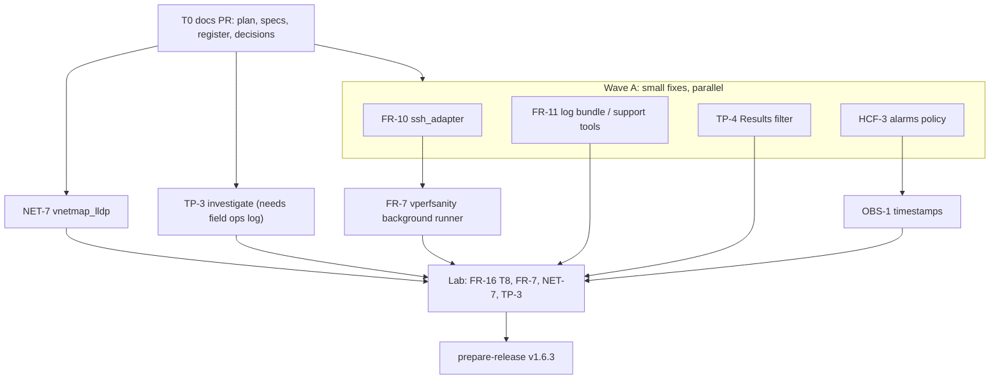

# v1.6.3 plan — critical fixes + NET-7

Scope and gates: [`spec.md`](spec.md). Tasks: [`tasks.md`](tasks.md). One branch and PR per item, each off
`develop` in its **own worktree** (never share a checkout with another chat; see the NET-7 handoff incident
note).

## Order (grouped by code area)

| Item | Branch | Main files | Runs after | Why |
| --- | --- | --- | --- | --- |
| T0 | `chore/v1.6.3-plan` | `docs/issues/*`, `docs/TODO-ROADMAP.md`, `docs/DECISIONS.md`, `docs/BRIEF.md` | — | Every later branch needs the specs on `develop`. |
| FR-10 | `fix/FR-10-paramiko-deadline` | `src/utils/ssh_adapter.py`, `tests/test_ssh_*` | T0 | FR-7 also edits `ssh_adapter`; land this first. |
| FR-11 | `fix/FR-11-remote-archive-cleanup` | `log_bundle_workflow.py`, `support_tool_workflow.py` | T0 | Independent. |
| TP-4 | `fix/TP-4-results-cluster-key` | `result_scanner.py`, `app.py` results route, `validation_results.html` | T0 | Independent (spec exists). |
| HCF-3 | `fix/HCF-3-critical-alarms-fail` | `health_checker.py` (alarms), `report_builder.py` fixup, `app.py`/`oneshot_runner.py` call sites, config | T0 | Behavior change; release notes. |
| OBS-1 | `fix/OBS-1-file-timestamps` | `utils/timestamps.py` (new), ~15 `strftime` call sites incl. `health_checker.py` | HCF-3 | Same file as HCF-3; avoid parallel edits. |
| FR-7 | `feature/FR-7-vperfsanity-background` | `vperfsanity_workflow.py`, `advanced_ops.py`, `oneshot_runner.py`, config, templates | FR-10 | Builds on FR-16 and the paramiko changes. |
| NET-7 | `feature/NET-7-vnetmap-lldp` (exists) | see [`../NET-7/plan.md`](../NET-7/plan.md) | T0 | Largest item; starts in parallel with wave A. |
| TP-3 | `fix/TP-3-techport-mgmt-ip` | `utils/vms_tunnel.py`, Network Extraction | field log / lab | Investigation first. |

`app.py`, `oneshot_runner.py` and the templates are touched by HCF-3, TP-4, FR-7 and NET-7, but in different
functions. Each PR rebases on `develop` before merge, and the later PR resolves any conflicts.

## Per-item procedure

`start-work` (worktree + branch) → failing-first test (bugs) or tests alongside (features) → `implement-change` →
targeted tests (`pytest tests/test_<module>.py -x --lf`) → independent review → changelog fragment in
`docs/issues/<ID>/changelog.md` → `bash scripts/quality-gate.sh` → `open-pr` to `develop`.

Wave A items and the NET-7 workers run as subagents (implementation model, not the read-only exploration
tier). Each gets the brief, its spec, its task and its file list; the parent reviews, integrates and runs the
final gate.

## Release

After every item is merged and the lab gates pass: `prepare-release` (version 1.6.3 in `src/app.py`
`APP_VERSION`, changelog assembled from fragments, `RELEASE_NOTES_v1.6.3.md` naming the HCF-3 and NET-7
behavior changes), then approval, `ship-release`, `publish-docs` and `update-tracker`.

## Owner inputs still needed

- Lab cluster access for FR-16 T8 and FR-7, plus a cluster where LLDP is already active on the nodes for NET-7.
- The field ops log behind TP-3 (scrubbed), or a lab Tech Port session.
