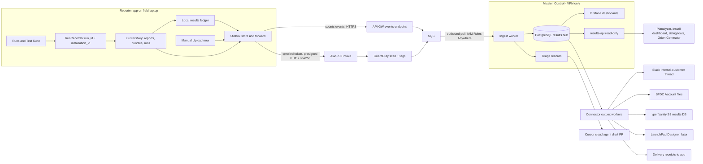

# Field diagnostics, results upload, and the Mission Control Results Hub

## 1. <customer> root cause (confirmed from the engineer's ops log and app log)

**Cluster:** <customer-cluster>, 12x EBox (12 CNodes / 24 DNodes), build `release-5.5.0-sp3-2697726`, about 6h12m uptime at run start, Tech Port 192.168.2.2, VMS internal <ip>. The Test Suite ran 17:28:52 to 18:31:26 PDT with five operations plus report and health.

The ops log (`logs/operations/oneshot_*.jsonl`, 2,740 entries) existed on the laptop and answered almost every question. The bundle simply never included it.

- **support_tools: an EBox incompatibility (bug, certain).**
  - Step 3 ran `/vast/data/vms.sh /vast/data/vast_support_tools.py inspect` on the VMS host and got `bash: /vast/data/vms.sh: No such file or directory`, rc=127, in 430ms. Step 3 still reported "completed" ([src/workflows/support_tool_workflow.py](src/workflows/support_tool_workflow.py) L501-506). Step 4 then failed generically.
  - On EBox, the wrapper lives in the container directory. Per the KB and the Slack threads (JaRam Jeon 2025-07, Austin Gossmeyer / <customer> 2026-09), the command is `/vast/data/C-4200/vms.sh /vast/data/C-4200/vast_support_tools.py inspect`. `vms.sh` is simply `docker exec -it $(docker ps -q --filter label=role=vms) "$@"`.
  - `VMS_PATH = "/vast/data/vms.sh"` is hardcoded (L84), so **support tools fail on every EBox cluster.**
- **vperfsanity: timeout budget shorter than the script's own flow, and no cleanup (bug, certain).**
  - The app runs `vperfsanity_run.sh -w -r pool0` as one blocking SSH call with `timeout=3600`.
  - The write dataset defaults to 4096 GiB per DBox. 12 x 4096 GiB = 52.77 TB, which exactly matches `logical_space_in_use_tb` in the report. So **writes completed**, as the engineer said.
  - The script then enters `wait_to_stop_bursting()`. It polls the burst state every 30s for up to `BURST_WAIT_TIMEOUT_S=7200`, and can only be skipped by pressing 'x' or passing `-W`, which invalidates the reads. The app's 3600s cap killed the session inside that wait, so **reads never started.**
  - The app log has zero entries from 17:29:50 to 18:30:05: no heartbeat, and the partial output was discarded ([src/utils/ssh_adapter.py](src/utils/ssh_adapter.py) L377-378).
  - Pre-validation told the engineer the test "may take up to 30 minutes".
  - `export VAST_VMS='192.168.2.2'` is a no-op, because the package reads `VMS_IP` from `/vast/vman/mgmt-vip`.
  - **Customer impact:** the one-shot breaks out after a failed step, so Step 7 cleanup never ran. The <customer> cluster still holds about 52.8 TB of test data, the `/vperfsanity` view and policy, the `vperfsanity` user, and elbencho services (the report confirms the view and policy are present).
  - The engineer's "about 3 hours" cannot be reconciled from the app. The app moved on at 18:29:57, so it was likely direct observation of the cluster afterwards; ask to confirm.
- **switch_config FAILED / vnetmap MISSING (bug, certain).**
  - VMS had no switches. Pre-validation warned but still ran the switch ops. `switch_config` queries only `GET /api/switches/`, gets nothing, and fails. The manual `+Switch` entries (hostnames `<customer-switch>`/`009`) are used **only for rack placement** and never as a switch source. This corrects the earlier hostname-resolution hypothesis.
  - vnetmap was not in the Test Suite selection.
  - In the Reporter-tile run at 17:20, vnetmap was invoked with an empty `-s`. That produced an argparse usage error, rc=2, which was misreported as "Authentication failed on all 3 candidate switch password(s)" (`vnetmap_workflow.py` L676/729/971).
- **log_bundle "OK" is actually partial (bug).** It copies `/var/log/vast` and `/var/log/syslog`, which don't exist on this 5.x/RHEL node. `|| true` hides the failure, so the bundle holds only `/var/log/messages` from the Tech Port CNode.
- **Health:** `Upgrade active: NOT_UPLOADED` should count as idle (HCF-1 extension). The EBox CBox-skipped message (HCF-2) and the empty Performance Baseline (HCF-5) are already fixed on this branch.
- **Cluster-side signals to share:**
  - DNode NIC link alarms (65 critical/major).
  - About 6k/hr ICMPv6 duplicate-address advertisements on `*.1262`, starting after cluster create, a possible L2 loop or MLAG/VLAN misconfiguration.
  - The NVMe reset at 18:06 UTC predates cluster create, during bring-up, so it is lower concern.
- **Immediate remediation for the engineer** (on the Tech Port CNode): `cd /tmp/vast_scripts/vperfsanity && ./vperfsanity_run.sh -c pool0 && ./vperfsanity_prepare.sh -c pool0`. If `/tmp` was cleared, re-extract the package first. Then verify capacity drops and `clush -a 'pgrep -a elbencho'` returns nothing. For a valid performance figure, run vperfsanity manually in `tmux` and let the burst wait finish.

**Does this change the plan?** Yes, in three ways:
1. **Phase 1 grows.** New must-fix bugs: the EBox wrapper, vperfsanity cleanup, switch-op skip logic, vnetmap with empty `-s`, and log bundle paths.
2. **Release split recommended.** These fixes affect customers, so they should ship quickly: v1.6.2 as Phase 1 plus the already-done HCF/INV work, with the recorder, ledger and export moving to v1.6.3.
3. **Data-gathering scope expands** (Section 6): a cluster capability probe, a residue/hygiene record, tool package versions, workflow parameters, and live remote-log streaming. Performance analytics also need test-condition fields (Section 9).

## 2. Logging today vs. what triage needs

**Captured today:**
- A rotating app log (global).
- An in-memory SSE queue and ops buffer, both lost on restart.
- The one-shot ops log, written at the end of a run only. No UI can list or download it (`OpsLogManager.list_logs()` is never called).
- Workflow artifacts, on success only.
- Local opt-in telemetry, which already has an anonymous `install_id` ([src/usage_metrics.py](src/usage_metrics.py) L85-105).

**Gaps:**
- Output Results is not persisted.
- Failed-step output and partial output are not persisted.
- No structured step timing.
- No environment snapshot.
- No run correlation ID.
- Local time and UTC are mixed in filenames.
- No operator notes.
- No diagnostics in the bundle.
- No way to upload anything.

## 3. Target architecture (hybrid, approved)

- S3 is reachable from any customer site, so engineers never need VPN to upload. The outbox also retries later.
- Mission Control only makes **outbound** calls to AWS and GitHub. It never gets inbound internet exposure.
- Raw artifacts stay in S3 as the source of truth, with a lifecycle policy. Mission Control stores structured data and fetches blobs on demand.
- The pattern matches established support-bundle tooling (Replicated/troubleshoot.sh): collectors, redactors, analyzers, outcomes. One versioned rules pack runs in the app, in the worker and in CI.

## 4. Identity, consent, and upload modes

- **Installation ID.** New `src/utils/installation.py` promotes today's telemetry `install_id` into a first-class `installation_id` (UUIDv4, stored in `<data_dir>/installation.json` and migrated from `telemetry.json`). It is stamped on every run, event, `manifest.json`, `diag_manifest.json` and upload.
  - An optional editable **install label** (for example "rstamps-mbp") makes installs readable.
  - On enrollment, Mission Control binds the installation to the engineer's SSO identity server-side, so uploads trace to a system and a person without storing the person in the app.
- **Tier 0: result counts (on by default).**
  - A first-run notice with opt-out. The allowlisted event schema (from `TELEMETRY.md`) is extended with `result_type` (report_pdf, report_json, bundle, test_suite_op), `success`, `app_version`, `os`, `event_id` (idempotent) and `ts`.
  - No customer content.
  - Goes to the API GW `/events` endpoint, authenticated with a low-trust per-release ingest key plus WAF throttling and strict schema validation. Enrolled installs' events are marked verified.
  - This reverses today's opt-in telemetry default, so it needs a DECISIONS entry and a `TELEMETRY.md` rewrite.
- **Tier 1: content (requires one-time enrollment).**
  - The engineer, on VPN, opens Mission Control, signs in with SSO and gets a one-time enrollment code. The app exchanges it for a revocable, upload-scoped per-install token (JWT signed by Mission Control; the API GW authorizer validates it against a static public key).
  - Once enrolled, reports (PDF and JSON), bundles and diagnostics **auto-upload** after each run.
- **Manual "Upload now".** Available after **every** run, whether it succeeded, partially completed or failed:
  - **Reporter page, Reporter pill** (report run): PDF, JSON, vnetmap output and the run diagnostics.
  - **Reporter page, Test Suite pill** with all or some operations selected: the validation bundle, whatever individual operation artifacts exist, and the run diagnostics.
  - **Results page:** any historical run, report or bundle.
  - **Output Results menu:** the current run.
  - The run's status (complete / partial / failed, per operation) is sent with the upload, so failed runs are uploadable and clearly labeled.
- **Upload dialog.**
  - Artifacts are pre-selected from the run and can be edited.
  - **Destinations**, each a checkbox with per-cluster-profile defaults:
    - Mission Control Results Hub (always on).
    - Slack `#internal-<customer>` thread.
    - SFDC Account "Notes & Attachments".
    - vperfsanity results DB (shown only when vperfsanity artifacts exist).
  - Optional operator notes.
  - Delivery happens server-side through the Mission Control relay (Section 9).
- **Tracking keys** on every upload, stamped by the app and enriched by the hub:
  - UTC timestamp, `installation_id`, `run_id`, run type (reporter / test_suite) and selected operations, completion status.
  - PSNT, cluster name, and customer name (from the cluster profile or the confirmed SFDC Account).
  - Engineer user ID (the SSO subject bound at enrollment; the OS username is kept only as a hint).
  - App version.
- **Upload queue and receipts.**
  - An "Upload queue" panel shows queued, uploading and uploaded items, with retry and cancel.
  - Once the hub has processed an upload, **per-destination receipts** appear: Slack permalink, SFDC file link, vperfsanity DB accepted. The app reads them from an API GW status endpoint that the Mission Control worker writes to.
  - The `upload_id` is shown for reference.
- **Controls.**
  - A per-run "Skip upload for this run".
  - A per-cluster-profile `upload_policy` (`allow` / `counts_only` / `none`) for customers that prohibit data leaving site.
  - A global off switch in Advanced Config.
  - A consent dialog lists exactly what is sent.

## 5. Phase 1: <customer> fixes (current branch `fix/v1.6.2-field-feedback`, failing-first tests, ship as v1.6.2)

Each fix gets a regression test built from the <customer> ops-log lines. Sanitized fixtures go in `tests/data/diagnostics/<customer>/`.

- **support_tools on EBox** ([src/workflows/support_tool_workflow.py](src/workflows/support_tool_workflow.py)):
  - Discover the wrapper: `/vast/data/vms.sh` first, then `/vast/data/C-*/vms.sh`.
  - Copy the script next to the discovered wrapper's directory, as the KB does.
  - Fail Step 3 on any non-zero exit code (127 means the wrapper is missing), on a timeout, or on empty output.
  - Scale the timeout with node count. Carry the exit code and stderr tail forward.
- **vperfsanity runner** ([src/workflows/vperfsanity_workflow.py](src/workflows/vperfsanity_workflow.py)):
  - Start the run detached on the CNode (`nohup ./vperfsanity_run.sh ... > /tmp/vperfsanity_<run_id>.log 2>&1 &`, with the PID recorded). Poll with short SSH calls every 30s.
  - Parse the phase (collecting, write, "Waiting for burst", burst fill %, read, done) and emit it as a heartbeat. Stream the log into the run recorder.
  - Replace the fixed 3600s cap with a budget: estimated write time from box count x dataset size, plus the script's 7200s burst-wait ceiling, plus read time. Add a stall detector for "no new output for N min".
  - Expose Quick vs Full profiles (`-s` dataset GiB per box, `-T` time limit) in the UI and config.
  - Fix the pre-validation duration estimate. Drop the no-op `VAST_VMS` export.
  - Cancel kills the remote PID.
  - Lab-validate on a small cluster and an EBox cluster.
- **Guaranteed vperfsanity cleanup.**
  - On failure, timeout or cancel, always run `vperfsanity_run.sh -c` followed by `vperfsanity_prepare.sh -c`, which removes the data, view, policy and user and stops elbencho.
  - [src/oneshot_runner.py](src/oneshot_runner.py) must run a workflow's declared cleanup steps even after an earlier step fails (a new `cleanup_steps` contract per workflow).
  - Offer an opt-out ("keep test data for debugging"), plus a post-run residue check.
- **Switch operations with no VMS switches.**
  - Pre-validation marks `switch_config` and `vnetmap` as SKIPPED, with guidance ("register switches in VMS, or enter switch management IPs"), instead of letting them FAIL.
  - Manual switch entries become a fallback source, but only IPs, or hostnames resolved from the CNode with `getent hosts`.
  - Validate input in the `+Switch` UI ([frontend/templates/reporter.html](frontend/templates/reporter.html)).
- **vnetmap:** never run the ETH command with an empty `-s`. Only report "Authentication failed on all N candidates" when an authentication failure is actually detected.
- **log_bundle:** collect `/vast/log` (container logs) from all nodes, and drop the nonexistent `/var/log/vast` and `/var/log/syslog`. Report PARTIAL when sources are missing instead of hiding it with `|| true`. Lab-verify the paths on 5.3, 5.4 and 5.5, EBox and C/DBox.
- **SSH timeouts keep partial output.** Keep `exc.stdout`/`exc.stderr` on `TimeoutExpired`, on both the subprocess and paramiko paths.
- **Idle upgrade state:** `NOT_UPLOADED` counts as idle ([src/health_checker.py](src/health_checker.py)).
- **FAILED placeholders** name the step, the error and the ops-log path. As a stopgap before Phase 2, the bundle also includes the session's `oneshot_*.jsonl` ops log. That one change alone would have made <customer> diagnosable from the bundle.

## 6. Phase 2: local recorder, ledger, export (v1.6.2 proposal; no uploads yet)

- **`src/utils/run_recorder.py`** covers every job type. It streams to `clusters/<key>/logs/runs/<run_id>/` incrementally so a crash still leaves a record:
  - `output_results.jsonl`: every emitted line.
  - `steps.jsonl`: UTC start/end, duration, exit code, timeout flag, and a redacted output tail.
  - `remote/<op>_<step>.log`: full remote transcript.
  - `app_debug.log`: per-run DEBUG log.
  - `environment.json`: app build, OS, connection mode, tool versions, disk, cluster identity and node counts, pre-validation results.
  - `run_summary.json`: operation status, failures and timings.
  - `operator_notes.md`: optional free text.
- **Correlation and redaction.** A `run_id` contextvar plus a logging filter. Value-based credential scrubbing on top of `SensitiveDataFilter`. UTC ISO-8601 everywhere.
- **Expanded data scope** (from the <customer> analysis). Each item would have shortened or prevented this diagnosis:
  - **Cluster capability probe** at pre-validation, read-only:
    - Platform: EBox vs C/DBox, container directories (`/vast/data/C-*`, `D-*`) and whether `vms.sh` is present.
    - Build, uptime, VMS host.
    - Switches-in-VMS count, internet reachability.
    - Deployment-tool package versions (vperfsanity `.version`, support tools, vnetmap).

    Operations are gated or adapted from the probe (for example, pick the EBox wrapper, or skip switch ops), and the results are recorded in `environment.json`.
  - **Workflow parameters** used by each operation: VIP pool, dataset size, threads, flags, and effective timeouts. Recorded in `steps.jsonl`.
  - **Live remote logs** for long operations (vperfsanity, support tools, vnetmap), streamed into `remote/`, so a hang shows its last phase.
  - **Cluster hygiene record:** objects the tool created (views, policies, users, background processes), capacity before and after each operation, and a residue warning at the end of the run. Stored in `run_summary.json` and the bundle.
  - **Silent-partial detection:** any step that suppresses errors (`|| true`, "continuing") records what was missing, so "OK" cannot hide partial collection.
  - **vperfsanity artifacts.**
    - After Step 5, copy the remote `vperfsanity/artifacts/` files to the laptop and add them to the bundle: `vperfsanity-results.csv` (the DB row), `elbencho-results.csv/.txt`, and `cluster-config.tar.gz` (VMS API dumps of alarms, capacity, cboxes, clusters, cnodes, dboxes, eboxes, dnodes, hosts, nvrams, nics, ssds, views, vms).
    - Record whether the Step 6 CNode upload (`vperfsanity_results.sh -U`) succeeded. It needs cluster internet; today a failure is silently reported as "Upload skipped".
    - The `ssds`/`nvrams`/`nics` dumps also feed DRV-1 (drive inventory/firmware) and INV-2 (MACs).
- **Local results ledger.** An append-only `results_ledger.jsonl` with one idempotent event per successful result.
  - A one-time **backfill** scans existing `clusters/*/reports` and bundles, so historical usage counts toward the global metric once uploads ship.
  - The Dashboard shows a local "Results generated on this install" tile, extending the Usage & Privacy card.
- **Bundle and export.**
  - A new `diagnostics` category in `ResultBundler`.
  - "Export Diagnostics" in the Output Results menu and on the Results page. Routes `GET /api/diagnostics/runs` and `POST /api/diagnostics/export`, which wire up `OpsLogManager.list_logs()`.
  - `diag_manifest.json` records schema_version, per-file sha256, run_id and installation_id.
- **vperfsanity parser.** `src/workflows/vperfsanity_parser.py` (advanced-ops layer) turns the raw results text into structured write/read GB/s, IOPS, latency and client count. It is shared with RCS-5 (Cluster Info) and the hub worker.
- **Rules analyzer.** `diagnostics/rules/*.yaml` plus `scripts/analyze_diagnostics.py`, with in-app hints after a failed run. Seed rules, each backed by a <customer> fixture:
  - SUPPORT-TOOLS-EBOX-WRAPPER (rc 127 plus `vms.sh: No such file`).
  - VPERF-BURST-WAIT-TIMEOUT (timeout after the write phase, with the dataset size).
  - VPERF-RESIDUE (cleanup skipped).
  - SWITCH-NONE-IN-VMS.
  - VNETMAP-EMPTY-S.
  - LOGBUNDLE-PARTIAL.
  - NIC-LINK-ALARMS.
  - IPV6-DAD-STORM.

## 7. Phase 3: Results Hub client in the app (v1.7.0)

- **`src/utils/results_uploader.py`** follows the never-raise HTTPS idiom in [src/updater.py](src/updater.py). It implements Section 4: enrollment, Tier 0 events, Tier 1 presigned PUT/multipart with signed `x-amz-checksum-sha256` plus SSE-KMS, and the outbox with backoff and resume.
  - It never blocks job threads.
  - Tokens stay in the OS keychain.
  - No AWS credentials ship in the app.
- **Transport consolidation.** It supersedes the separate "diagnostics upload" client and becomes the single transport for UPL-1 (results posting).
- **Config.** A new `results_hub.*` block in [config/config.yaml.template](config/config.yaml.template) and `README.md`: endpoint, `counts_enabled` (default true), `auto_upload` (default true once enrolled), size limits.

## 8. Phase 4: AWS intake (infra repo `results-intake-infra`)

- **Bucket.** S3 with Block Public Access, a customer-managed KMS key, and a deny for non-TLS and unencrypted PUTs. Versioning, CloudTrail data events and lifecycle expiry (raw data after N days, per policy). Key layout: `incoming/`, `accepted/`, `quarantine/`, `rejected/`.
- **API.** API Gateway with a <customer> `create_upload` / `complete_upload` (presign, key scoping, size limits, JWT authorizer) and `POST /events` (schema-validated, WAF plus throttling, batched to SQS).
- **Scanning.** GuardDuty Malware Protection for S3 with tag-based access control: only `NO_THREATS_FOUND` objects are readable. Scan results and events go to SQS for the Mission Control pull.
- **Region.** <customer> is Canadian (PIPEDA). `ca-central-1` or per-geo buckets need Security/Legal sign-off.

## 9. Phase 5: Mission Control Results Hub (repo `results-hub`, containers on MC)

Mission Control today is a Windows 10 VM running Docker Desktop, serving nginx over HTTP on :80. It already runs a PostgreSQL 16 stack for install-heatmap.

**Prerequisites** (Mission Control Phase 2 hardening):
- HTTPS with an internal CA certificate for `<lab-host>`.
- oauth2-proxy with SSO in front of the UI and API.
- The DB port is never published. Confirm the `5433` exposure noted in the VM plan is closed.
- Nightly encrypted `pg_dump` to S3.
- A capacity and resource review. Evaluate the deferred Linux host migration.

**Database** (PostgreSQL 16, separate `results_hub` DB, Alembic migrations):
- `installations`: id, label, first_seen, last_seen, app_version, os, enrolled_subject.
- `events`: event_id primary key, installation_id, result_type, success, ts, app_version, verified.
- `uploads`: upload_id, kind, s3_key, sha256, size, scan_status, validation_status.
- `runs`: run_id, installation_id, cluster_uid, engineer_id, run type, selected operations, times, per-operation status, completion status, connection mode.
- `clusters`: cluster_uid (hash of PSNT/GUID), name, PSNT, version, customer_id.
- `customers` / `accounts`: customer name, SFDC Account ID, and the Slack channel ID plus parent thread per deployment. Confirmed once by an engineer and cached.
- `engineers`: SSO subject, email, display name, and installations.
- `artifacts` / `files`: one row per extracted file (path, type, size, sha256, S3 key, extracted text for search).
- `report_documents`: full `vast_data_*.json` as JSONB with schema_version, which enables dynamic import and query of any field.
- `hardware_profile`: C/D/EBox models and quantities, CNode/DNode quantities, drives (after DRV-1), switch models, IB/ETH, topology (leaf/spine, MLAG), MTU and `nb_eth_mtu`, link speeds, VIP counts.
- `perf_results`: vperfsanity write/read GB/s, IOPS, latency, clients, VIP pool, raw reference. It also records the **test conditions that make profiles comparable**: `dataset_gib_per_box`, threads, protocol (S3/NFS), `burst_wait_s`, `burst_wait_skipped` (invalidates reads), write and read durations, vperfsanity and elbencho versions, and platform (EBox vs C/DBox) with box counts. Runs without a completed read phase or with a skipped burst wait are flagged and excluded from the performance-profile dashboards.
- `health_results` and `diagnostics` (fingerprint, classification, analysis JSONB).
- Views: `v_total_results`, `v_perf_by_hardware`, `v_adoption`.

**Ingest worker** (Python, reusing the app's parsers):
- Pulls from SQS, authenticating with IAM Roles Anywhere (no long-lived keys).
- Admits only scan-clean objects. Validates JSON Schema, sha256 and zip safety.
- Idempotent upserts keyed by `upload_id` and sha256.
- **Unzips before ingest.** Bundles and zips are extracted into a staging area with zip-slip and zip-bomb limits. Each file gets a row in `artifacts`, and extracted blobs go to S3 `accepted/.../extracted/`.
- **Indexes content for search.**
  - Postgres full-text search (`tsvector`) over logs, text outputs and flattened report JSON, with GIN indexes on the JSONB columns.
  - Search by PSNT, cluster, customer, engineer, date, model, error text or fingerprint.
  - OpenSearch is a later option if volume demands it.
- Normalizes report JSON, vperfsanity (including `vperfsanity-results.csv`), health and vnetmap into the tables above.
- Runs the rules analyzer and fingerprinting, then creates or updates triage records (Phase 6).

**Dashboards** (Grafana OSS, provisioned from git, generic-OAuth SSO, Mission Control portal tile):
- **Total Results Generated:** global total, trend, split by type, app version, region and install, plus a backfilled history.
- **Adoption:** active installations and engineers, and uploads compliance (the Field Procedure 100% posting target).
- **Performance profiles:** vperfsanity by hardware model and quantity and by network topology, speed and MTU.
- **Test Suite pass rates:** per operation.
- **Top diagnostics fingerprints.**

**Read API** for other tools (`results-api`, FastAPI with OpenAPI, under `/api/results/v1/` behind Mission Control's nginx):
- Read-only endpoints: total-results, clusters, runs, report JSON, perf profiles with hardware and network filters, search.
- Per-tool **scoped service tokens**, rate limiting and an audit log.
- A read-only Postgres role for BI tools.
- A nightly Parquet export for ad-hoc analysis.
- First consumers:
  - Planalyzer (plan vs. as-built).
  - Install Daily Dashboard.
  - Ross's sizing and licensing tools (predicted vs. actual capacity and performance, the original ask).
  - Orion-Generator.

**Destinations and connectors** (Mission Control relay, approved). Delivery runs server-side with service credentials, so no destination tokens ever sit on laptops.

- **Connector framework.**
  - A canonical entity model (customer/account, cluster, run, artifact, delivery, issue).
  - An `external_refs` crosswalk table (entity, system, external_id, url, synced_at) for Slack, SFDC, LaunchPad, Jira, Confluence and the vperfsanity DB.
  - A **transactional outbox**: an ingest commit enqueues delivery jobs, and connector workers process them with idempotency keys, retries with backoff, a dead-letter queue and an audit trail. `deliveries` rows hold upload_id, destination, status, external_id or link, attempts and error.
  - A read API plus webhooks, so other internal systems can subscribe to events such as `run.ingested` and `report.available`.
- **Account and channel mapping** (approved: auto-suggest, engineer confirms).
  - On first upload for a cluster, the hub looks up the SFDC Account by PSNT (Asset / installed-base record; the object and field are to be confirmed with the SFDC admin).
  - It suggests the `#internal-<customer>` channel from the account or customer name, using `conversations.list`.
  - The engineer confirms or corrects this once, in the Upload dialog or on Mission Control. It is cached in `customers` and pushed back to the cluster profile.
- **Slack connector** (Slack app / bot).
  - Scopes: `chat:write`, `files:write`, `channels:read`, `groups:read`. The bot must be invited to private channels.
  - Files are posted with `files.getUploadURLExternal`, then an upload, then `files.completeUploadExternal` with `channel_id` and `thread_ts`.
  - Thread strategy: one parent message per cluster deployment ("As-Built results: <cluster> / <PSNT>"), with its `thread_ts` stored, so later runs reply in the same thread. An engineer-pasted thread link overrides it.
  - The message uses the Field Procedure's Slack template, a status summary (pass / partial / fail per operation) and "posted on behalf of <engineer>".
- **SFDC connector.**
  - A Connected App using the OAuth 2.0 JWT bearer flow with an integration user.
  - Uploads a `ContentVersion` (multipart, large files supported) with `FirstPublishLocationId` set to the Account ID, so it shows in the Account's Files / Notes & Attachments.
  - An optional `ContentNote` with the run summary and a link back to the hub.
  - Dedupe by sha256.
- **vperfsanity results DB connector.**
  - How it works today:
    - `vperfsanity_results.sh -U` (or `helpers/vperfsanity_upload.sh <csv>` from a laptop) runs `aws s3 cp` of `vperfsanity-results.csv`, `elbencho-results.*` and `cluster-config.tar.gz` to `s3://vast-vperfsanity/results/<PSNT>/<YYYYmmddHHMMSS>-<file>`.
    - A job renders the results into [<lab-host>/vperfsanity.html](https://<lab-host>/vperfsanity.html) within about an hour, per the [KB](https://vastdata.atlassian.net/wiki/spaces/KB/pages/5714051478/Cluster+performance+validation+with+vperfsanity). That page is a DataTables table of about 230 rows: timestamp, PSNT, build, encryption/similarity/bursting/DBox-HA flags, cluster size, CNode types, read/write CNode counts, bandwidth total, per CNode and per DBox, and the cluster-config link.
  - What the Test Suite does today:
    - It **already includes the flag**, as Step 6 `vperfsanity_results.sh -U` run on the CNode.
    - That only works when the cluster has internet (<customer> had none), and Step 5 never copies the artifacts to the laptop.
  - Plan:
    - The Phase 2 artifact copy captures the files.
    - The hub relay performs the laptop-style upload to the same bucket and key layout when the CNode upload didn't happen. Dedupe by PSNT plus timestamp.
    - This uses relay credentials agreed with the vperfsanity owner (package author `breuner`), or an official ingest path if they prefer one.
  - Security note: the package embeds long-lived upload-only AWS keys in `helpers/vast_common_lib.sh`. The app and hub must never extract or reuse them, and the tarball must stay out of git and the DMG. It is gitignored under `output/tools/`; confirm the packaging spec never bundles it.
- **LaunchPad connector** (Designer imports as-built JSON to seed expansion designs).
  - Phase A:
    - A versioned as-built JSON contract (`metadata.schema_version`) with a CI contract test against the LaunchPad import format, coordinated with the SE Tools team.
    - An "Open in LaunchPad" / "Export for LaunchPad" action in the app and hub.
  - Phase B: server-side push of the as-built JSON into Designer through the GraphQL API at `launchpad.vastdata.com/graphql`. Per the [Launchpad Developer Guide](https://vastdata.atlassian.net/wiki/spaces/STT/pages/6352240641/Launchpad+Application+Developer+Guide), Community Apps use a single-user PAT, so automation for all engineers needs an **Integrated Application** registration (M2M keys) with the SE Tools team.
  - Reuse `lp-productcatalog` (Generic, OEM and Variant part hierarchy) to map VMS model strings to friendly names and drive sizes (RCS-1). Reuse `lp-performance` for predicted-vs-measured vperfsanity (Ross's ask).
- **Jira and Confluence connectors (later).** Optional: file or link triage records in Jira, and publish a per-cluster as-built summary page to Confluence. Both need a service account; the current Atlassian MCP access is read-only.

## 10. Phase 6: triage automation and CI

- **Triage records.** The worker creates or deduplicates triage records by fingerprint in a **private** triage repo (for example `ps-deploy-report-triage`) using a GitHub App token, and adds occurrence comments on repeats.
- **Cursor agent.** The label `triage-ready` triggers a GitHub Action that runs a Cursor Cloud Agent via the Python `cursor-sdk` against `rstamps01/ps-deploy-report`.
  - It receives only the sanitized excerpt.
  - It drafts `docs/issues/<ID>/spec.md` and a failing-first test, then opens a DRAFT PR.
  - It never merges. The `pause_before` gates and `remediate-failure` escalation stay in force.
- **Public disclosure.** A sanitized public issue and roadmap entry are created only when a fix is scheduled.
- **CI in the app repo.**
  - A `diagnostics-rules` job runs against sanitized fixtures, starting with <customer>.
  - Contract tests for `diag_manifest`, the events schema and the report JSON schema (app-to-hub compatibility; schema_version bump rules).
  - Pipeline metrics in [docs/PIPELINE-METRICS.md](docs/PIPELINE-METRICS.md).
- **Secrets,** per [docs/development/PIPELINE-SECRETS.md](docs/development/PIPELINE-SECRETS.md): `CURSOR_API_KEY`, the GitHub App key, the Roles Anywhere certificate, and the ingest key per release. All stay out of git; the endpoint and region go in the template.

## 11. Governance, decisions, release mapping

- **Approved decisions:** hybrid topology (S3 intake plus a Mission Control pull), tiered collection, and a private triage store before any public issue. Record them in `DECISIONS.md`.
- **Sign-offs needed:**
  - VAST Security/Legal: data classification, retention, region, and the Tier 0 default-on notice text.
  - AWS account ownership.
  - The SSO client for oauth2-proxy and Grafana.
  - Mission Control hardening, since it holds customer data behind VPN.
  - Slack workspace admin: bot app approval and scopes.
  - SFDC admin: Connected App, integration user, and which Asset field holds PSNT.
  - vperfsanity owner: relay credentials or ingest path.
  - SE Tools team: LaunchPad Integrated Application registration and the JSON import contract.
- **Redaction levels:** "internal" for S3 and the hub; "sanitized" (consistent tokenization) for anything shared outside, such as public issues.
- **Follow-up:** move the data directory to OS-standard locations, since writing next to `.app` or `Program Files` can fail. Note that a new data directory also means a new installation_id unless it is migrated.
- **Release mapping (proposed, revised after the <customer> root cause):**
  - v1.6.2, fast-tracked because the bugs affect customers:
    - Phase 1: EBox support tools, the vperfsanity runner with guaranteed cleanup, switch-op skip logic, the vnetmap empty-`-s` fix, log bundle paths, SSH partial output, and the ops log in the bundle.
    - Plus the finished HCF/INV/SR-2/RPT work on this branch.
    - A field advisory goes out for v1.6.1 users now.
  - v1.6.3: Phase 2 (recorder, capability probe, hygiene record, installation_id, ledger with backfill, diagnostics export, vperfsanity parser, local analyzer). Nothing leaves the laptop.
  - Backend MVP in parallel, in separate repos: AWS intake, Mission Control hardening, DB, worker, and Grafana with Total Results plus performance profiles.
  - v1.7.0: the Results Hub client (counts default-on, enrollment, manual and auto upload, the Upload dialog with destinations and receipts), shipped once the backend MVP is live. Hub connectors MVP: Slack, SFDC and the vperfsanity DB relay. This automates Field Procedure step 13 and supersedes UPL-1.
  - v1.7.x: LaunchPad (Phase A, then B), read API consumers, triage automation, Jira/Confluence connectors, and RCS-1–5 surfaced from hub data.
